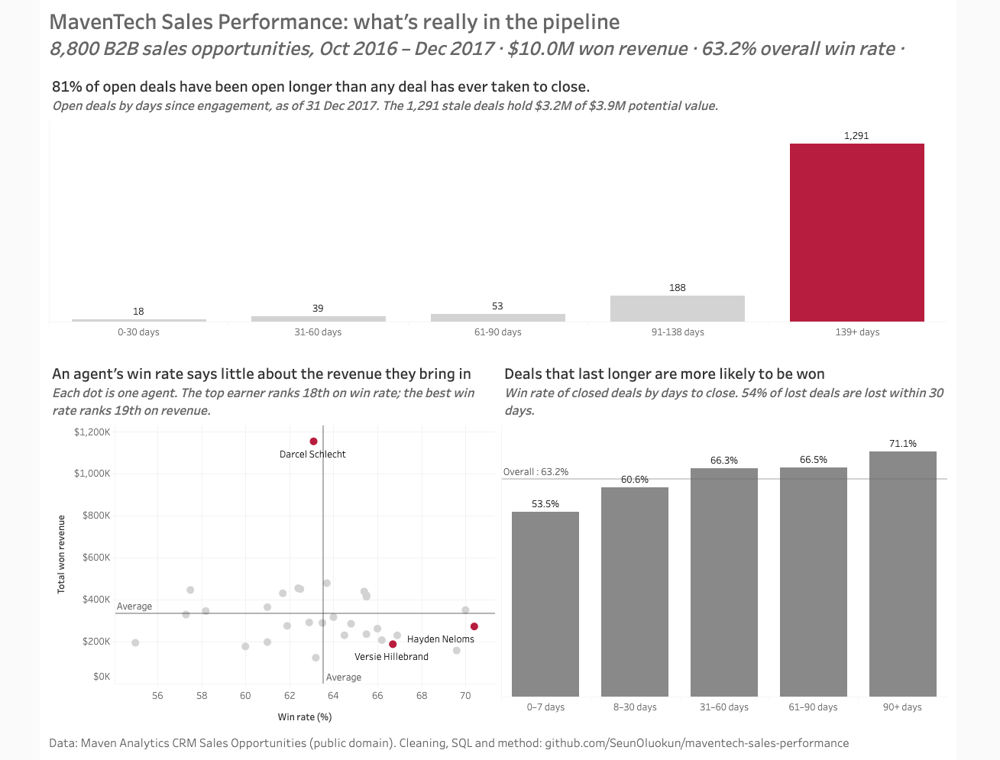

# MavenTech Sales Performance Analysis
 
**81% of the open sales pipeline has been open longer than any deal has ever taken to close.** This project analyses 8,800 B2B sales opportunities to find which agents, teams and products win deals, and where the pipeline is stuck.
 
### 📊 [View the interactive dashboard on Tableau Public](https://public.tableau.com/app/profile/oluwaseun.oluokun/viz/MavenTechSalesPerformance_17935299241160/Dashboard1)
 

 
**Tools:** Excel (cleaning and validation) · SQL / SQLite (analysis) · Tableau Public (visualisation)
**Data:** [Maven Analytics – CRM Sales Opportunities](https://mavenanalytics.io/data-playground) (public domain): accounts, products, sales teams and 8,800 opportunities, Oct 2016 – Dec 2017.
 
---
 
## The business question
 
A sales leader wants to know: **which agents, teams and products actually win deals, and how much of the open pipeline can be trusted?**
 
## Key findings
 
### 1. The open pipeline is heavily inflated
- **1,291 of 1,589 open deals (81%)** have been open longer than 138 days, the longest any closed deal has ever taken.
- These stale deals hold **~$3.2M of the ~$3.9M** potential pipeline value (82%, estimated at list price).
- A realistic live pipeline is **~298 deals worth ~$0.7M**. A forecast built on the full pipeline would overstate likely revenue several times over.
**Recommendation:** review and close out stale deals, and flag any deal open past ~138 days for follow-up. *(The data can't show whether these deals are genuinely stuck or were never updated in the CRM. Either way, the pipeline figure can't be trusted as it stands.)*
 
### 2. Win rate and revenue don't line up
- **Darcel Schlecht** is #1 on revenue ($1.15M) but #18 on win rate (63.1%). **Hayden Neloms** is #1 on win rate (70.4%) but #19 on revenue.
- Revenue is driven by **deal volume and price**, not win rate: Darcel closed 553 deals (average ~224) at ~$3,300 per win (average ~$2,360).
- Win rate genuinely differs between **agents** (55.0%–70.4%), but barely between **teams** (62.1%–64.4%) or **products** (60.0%–64.8%).
**Recommendation:** high-win-rate, low-revenue agents are the biggest opportunity. Coaching them toward higher-value products or more pipeline would grow revenue without hurting conversion.
 
### 3. Most deals are lost early
- **54.4% of all lost deals** are lost within the first 30 days.
- Win rate rises steadily with time in the pipeline: **53.5%** for deals closed within a week, **71.1%** for deals open 90+ days.
**Recommendation:** better qualification at the start of the pipeline would cut wasted effort on deals that were never going to close. *(Correlation, not causation: keeping a deal open longer doesn't make it more likely to win; weak deals simply drop out sooner.)*
 
---
 
## Approach
 
1. **Cleaned and validated in Excel:** fixed a product-name mismatch that would have silently dropped deals from joins, corrected a sector typo, and checked stage logic (e.g. open deals can't have a close value).
2. **Confirmed undocumented units:** the data dictionary doesn't say whether `close_value` is in dollars or millions, so I compared won deals to list prices (median ratio 0.998). It's dollars.
3. **Loaded into SQLite and verified:** found and fixed blanks imported as empty text, 0s introduced during Excel conversion, and numbers silently stored as text (SQLite doesn't enforce column types).
4. **Analysed in SQL:** win rates by agent, team and product; revenue vs win rate using CTEs and window functions (`RANK()`); deal cycle time with date maths; pipeline ageing against a 31 Dec 2017 snapshot date.
5. **Visualised in Tableau Public:** SQL stays the source of truth; Tableau is used only for presentation.
Full cleaning decisions are in [cleaning_log.md](cleaning_log.md).
 
## Repository structure
 
| Path | Contents |
|---|---|
| `data/raw/` | Original CSVs and data dictionary (untouched) |
| `data/clean/` | Cleaned Excel files and CSV exports |
| `data/output/` | Query results used by the dashboard |
| `sql/01_cleaning_and_verification.sql` | Post-import fixes and validation checks |
| `sql/02_win_rate_by_agent.sql` | Win rate by sales agent |
| `sql/03_win_rate_by_team.sql` | Win rate by sales team (JOIN) |
| `sql/04_win_rate_by_product.sql` | Win rate, deal value and revenue by product |
| `sql/05_revenue_vs_win_rate_by_agent.sql` | Revenue vs win rate ranking (CTE, `RANK()`) |
| `sql/06_deal_cycle_time.sql` | Time to close and win rate by time band |
| `sql/07_pipeline_ageing.sql` | Age and value of open deals |
| `cleaning_log.md` | Every cleaning decision and why |
 
## Key assumptions
- **Win rate = Won ÷ (Won + Lost).** Open deals are excluded.
- **Snapshot date = 31 Dec 2017**, the last date in the data.
- **Open-deal value is estimated at list price**, since won deals close at almost exactly list price.
- **Overall win rate is 63.2%** (total won ÷ total closed), not the average of group rates, which gives small groups too much weight.
## What I'd do next
- Add a quarterly trend to see whether the stale pipeline is growing.
- Break stale deals down by agent, to target pipeline clean-up.
- Win rate by sector (excluding the 1,425 open deals with no account).
 
